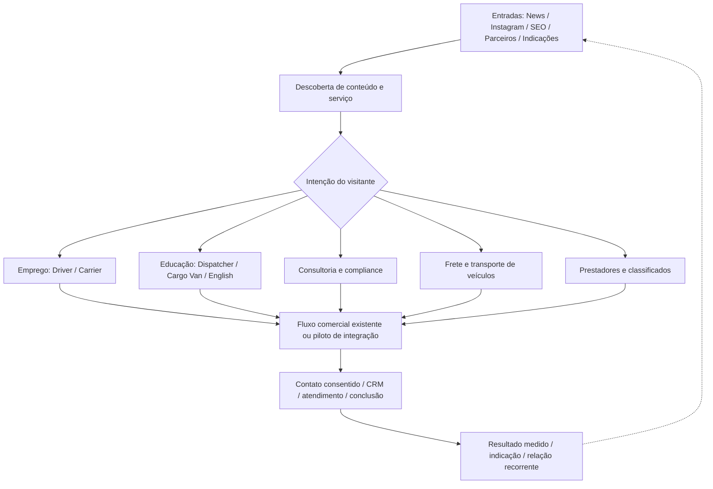
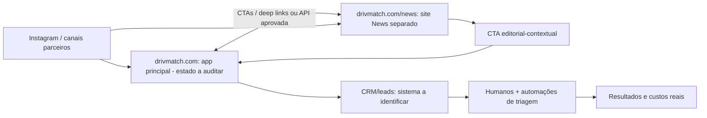

# DRIVMATCH ECOSYSTEM 360° — ECOSYSTEM MASTER

> **ATUALIZAÇÃO AUDITADA 12/10:** o repositório privado principal `DrivMatch/drivmatch` foi acessado com a segunda conta GitHub. O app **já contém** Marketplace de providers, candidatura e aprovação, fluxo `Request a Quote`, equipamento/classificados, DrivMe, dashboards de driver/carrier/dispatcher, Stripe e Supabase. A classificação anterior de repositório principal `UNKNOWN` se refere à indisponibilidade **da conexão anterior**, agora resolvida. Ver [APP_MAIN_READONLY_AUDIT_2026-10-12.md](APP_MAIN_READONLY_AUDIT_2026-10-12.md). Sem testes de produção nesta inspeção; não duplicar estes módulos.

**Data de consolidação:** 2026-10-12  
**Estado:** proposta documental para revisão; sem autorização de deploy, novas cobranças ou lançamento público  
**Escopo:** DrivMatch (plataforma/negócios) + DrivMatch News (mídia) + educação + parceiros + serviços + solicitações

> **Como usar:** esta é a visão estratégica transversal. Para operação de News, continuam canônicos `content/release.json`, `docs/CONTINUIDADE_DRIVMATCH_NEWS.md`, docs de release v34.x e issue [#18](https://github.com/handsondispatcher/drivmatch-news/issues/18). Para estratégia comercial anterior, preservar [WAR_ROOM 09/10](WAR_ROOM_ESTRATEGIA_DRIVMATCH_NEWS_E_RECEITA_2026-10-09.md). Este arquivo **não** aprova preços, não substitui gates e não modifica o código existente.

## 1. Tese e constituição operacional

**DrivMatch:** ambiente em que o setor de transporte dos EUA pode informar-se, aprender, trabalhar, contratar, solicitar transporte, encontrar prestadores, colaborar e realizar negócios legítimos.  
**DrivMatch News:** porta informativa/educativa com identidade editorial independente; não um jornal isolado nem publicidade disfarçada. O leitor pode acompanhar outros veículos simultaneamente.  
**Visão de helicóptero:** toda objeção deve ser investigada sob três perspectivas — risco real, mitigação e oportunidade/aliança potencial — sem confundir otimização comercial com obrigação de transformar todo risco em vantagem.  
**Colaboração:** advogado de tickets, oficina/borracharia, dealer, dispatcher, carrier, mídia e criador podem acumular, com critérios transparentes, papéis de anunciante, fornecedor, especialista, fonte e distribuidor. A comissão não compra a conclusão jornalística.  
**Valores declarados pelo fundador:** ajudar pessoas, compartilhar informação, reduzir fraude e abrir oportunidades, com inspiração cristã/espírita pessoal, sem imposição religiosa ao leitor.  
**Capital:** preferência estratégica declarada por bootstrap, controle societário de 100% e sem venda de equity/stock options, sempre que viável.  
**Operação:** agentes de IA e infraestrutura enxuta; custo fixo baixo **não é custo total zero**. Controles humanos em alegações graves, licenças, contratos, finanças, compliance e publicação sensível.

## 2. Registro de evidência (não inflar o estado)

Legenda: `REPO_VERIFIED` inspecionado em GitHub; `USER_DECLARED` relatado pelo fundador; `GEMINI_REPORTED` consta em análise Gemini simulada; `PLANNED` intenção; `UNKNOWN` precisa de teste. "Publicado tecnicamente" não significa "liberado comercial/editorialmente".

| Ativo / capacidade | Classificação em 12/10 | Evidência / ressalva |
|---|---|---|
| News release v34.11 | REPO_VERIFIED / DEVELOPMENT_PRELAUNCH | `content/release.json`: `public_launch_approved=false`; versão pode evoluir após esta data |
| Publicação News, reprodução Road TV e frescor editorial | REPO_VERIFIED como questões **em aberto** | Issues [#18](https://github.com/handsondispatcher/drivmatch-news/issues/18), [#59](https://github.com/handsondispatcher/drivmatch-news/issues/59), [#36](https://github.com/handsondispatcher/drivmatch-news/issues/36), [#35](https://github.com/handsondispatcher/drivmatch-news/issues/35); não revalidamos playback/deploy nesta revisão |
| Plataforma central `drivmatch.com`, cadastros | USER_DECLARED + PREVIOUS_SESSION_RECORDED; produção ainda exige rechecagem atual | Histórico de 09–11/10: repositório privado `DrivMatch/drivmatch` acessado em navegador autorizado, Lovable com banco Supabase e publicação via Cloudflare Pages. A conexão GitHub **deste chat** listou somente News e devolveu 404 para o privado; isso não anula os acessos já liberados por Ricardo. |
| Cursos dispatcher: mais de 500 alunos | USER_DECLARED | Contagem por curso, não usuários únicos auditados |
| Curso cargo van: 300 alunos | USER_DECLARED | Pode haver sobreposição com dispatcher; não somar 800 como pessoas únicas |
| Instagram `@fabriciodispatcher` | USER_DECLARED | Há seguidores e divulgação de parceiros; audiência, contratos, receita e conversões não auditados |
| Divulgação de seguro saúde e Oficina Gorila, Massachusetts | USER_DECLARED | Anúncios/divulgação já realizados; **não** inferir contrato pago, licença ou receita |
| Consultorias (transporte, dispatch, broker e investidor), serviços DOT/MC/BOC-3/UCR/Login.gov/Motus/TWIC/New Entrant/licenças | USER_DECLARED | Escopo contratual, licenciamento, números e oferta digital requerem levantamento |
| Brokerage e transporte de veículos pelos EUA; dispatchers parceiros | USER_DECLARED | Operações relatadas; autoridade, parceiros, cobertura e integrações pendentes de comprovação |
| Empregos/classificados e fretes B2C | PLANNED/UNKNOWN quanto aos fluxos digitais | Há propostas anteriores e possíveis funções no app; testar antes de concluir se existe ou está faltando |
| Marketplace de prestadores | USER_DECLARED como atividade relacional / PLANNED como escala digital | Usar exemplos atuais para um piloto, sem presumir diretório funcional |
| DrivMatch English Lab | PLANNED | Validar MVP, oferta, idioma, preço e conversão antes de declarar disponível |
| Paulo Landim / Road TV e demais parceiros de mídia | OPPORTUNITY / NOT LICENSED | Sem presunção de acordo, autorização de reprodução ou receita |

**Atenção ao relatório Gemini Missão 01 v1.0 (12/10/2026):** a própria execução declarou acesso simulado a repositórios, mas utilizou `VERIFIED_LIVE` para operações e supôs receita em divulgação. Reclassificamos tais itens como `USER_DECLARED`. Não copiar o estado simulado para reporting público. Existe também um War Room anterior com números de homepage e cadastros **não conciliados**: não declarar estatísticas de usuários/matches sem auditoria.

## 2A. Infraestrutura principal informada e anteriormente acessada (continuidade recuperada em 12/10)

- **GitHub privado:** `DrivMatch/drivmatch`, branch `main`; histórico de 09–11/10 registrou acesso em navegador autorizado pelo Ricardo, snapshot `snapshot/p1-before-codex-2026-10-11` e commit `b785ab3` (`Add News link to public header`). A referência é histórica; verificar HEAD antes de alterar.
- **Lovable / Supabase:** Ricardo esclareceu que o banco utilizado pela aplicação é o do Lovable, tecnicamente Supabase ("Supabase dentro da Lovable"). Não tratar como banco separado que precisa ser criado ou como infraestrutura não informada.
- **Cloudflare:** histórico de acesso autorizado à conta, Pages `drivmatch-app`, `drivmatch-app.pages.dev` e domínio `drivmatch.com`; conexão da Pages com repositório `main` registrada anteriormente. Um Worker `drivmatch` separado apresentou problema de build Vite 5 vs exigência de Vite 6+ e sem rotas ativas; **não confundir Worker com deploy produtivo Pages**.
- **Limite desta sessão:** o conector GitHub atualmente conectado enxerga apenas `handsondispatcher/drivmatch-news`; sua resposta 404 ao repositório privado não revoga o acesso previamente liberado, nem prova indisponibilidade do código.
- **Diretriz:** não solicitar novamente credenciais, senhas nem repetição de instruções do Ricardo. Usar o ambiente autorizado adequado para retomar a verificação somente-leitura, sem publicar dados sensíveis nem alterar produção.

## 3. Arquitetura comercial — conexões sem reconstruir tudo

**Regra:** sem "cadastro universal" forçado; usar o menor dado necessário para cada jornada e obter consentimento adequado. Não criar banco paralelo/matching novo no repositório News se fluxo apropriado já existir no app principal.

## 4. Portfólio por ondas (sujeito ao inventário)

| Onda | Ofertas | Estratégia |
|---|---|---|
| 0 — PROTEGER/CONFERIR | News vigente, serviços/cursos existentes, Instagram, CRM, cadastros, parceiros | Auditar, preservar, corrigir inconsistências, garantir suporte e controles |
| 1 — CONECTAR | News → vagas/ofertas reais, cursos, consultoria, solicitações de transporte, anúncio de parceiro | CTAs contextuais, atribuição, formulário/CRM ou fluxo atual comprovado; nada de novo matching se desnecessário |
| 2 — MULTIPLICAR | Diretório inicial de prestadores, colunistas, anúncios, carrier recruiting, English Lab conforme capacidade real | Pilotos pequenos, contratos/direitos, analytics, economia por parceiro e por fluxo |
| 3 — EXPANDIR | Classificados, storage/parking, DrivMe, rewards, benefícios, integrações amplas | Entrar apenas após prova de procura e capacidade de atendimento |
| 4 — OPCIONAL REGULADO | Wallet, intermediários financeiros, novos pagamentos complexos | Somente com estudo jurídico, estrutura contratual e necessidade comprovada |

**News mantém status próprio de lançamento.** Operações comerciais relatadas podem existir antes de a News ser autorizada ao público. Não usar fases "lançar/ativar" como se o fundador ainda não tivesse negócios ou divulgação.

## 5. Jornadas prioritárias de baixo retrabalho

1. Leitor de matéria sobre CDL/inspeção → recurso gratuito seguro → vaga real ou idioma/English Lab **se disponível** → clique medido → confirmação/atendimento.
2. Leitor sobre abrir transportadora → explicação educativa não enganosa → consultoria relacionada → triagem → proposta → execução registrada.
3. Carrier interessado em contratação → landing / contato → vaga validada e termos → candidatos com consentimento → acompanhamento; não cobrar motoristas por candidatura.
4. Pessoa física precisa transportar veículo → especifica origem/destino/datas → encaminhamento a operador com autoridade aplicável → cotação e confirmação fora do conteúdo editorial.
5. Motorista necessita pneus/reparo → matéria com informação neutra + diretório de prestadores/serviços claramente identificados → contato com prestador → feedback.
6. Parceiro Oficina Gorila / anúncio de seguro → campanha no Instagram → URL rastreável em DrivMatch se autorizado → qualificação de contato e conversão; não presumir pagamento, especialidade/representação ou certificação.
7. Colunista advogado de multas → credenciais/jurisdição verificadas → proposta editorial sob revisão → anúncio ou patrocínio **separado e identificado** → profissional mantém independência.
8. Criador Road TV / Paulo Landim → contato formal → permissões/licenças específicas → conteúdo atribuído e hospedado/incorporado conforme termos → divulgação recíproca; sem reupload sem licença.

## 6. Programa de parceiros (papéis cumulativos, controles separados)

Tipos: `SPONSOR`, `ADVERTISER`, `PROVIDER`, `EXPERT_COLUMNIST`, `EDITORIAL_SOURCE`, `DISTRIBUTOR`, `REFERRAL_PARTNER`, `CLIENT`. Mesmo parceiro pode ter vários tipos, mas decisões editoriais não dependem de aporte comercial.

Campos mínimos do cadastro B2B: entidade e contato empresarial; categoria/estado/área de atendimento; oferta e limites; licenças quando relevantes; página/CTA; consentimento e preferências de contato; contrato e direitos; forma de remuneração; data de verificação; queixas e status; conflito de interesses; medição agregada de encaminhamentos.

Modelos a testar (não aprovados): diretório gratuito com destaque; patrocínio identificado; artigo de especialista não pago condicionado à qualidade; conteúdo patrocinado com `Publicidade/Patrocinado`; campanha por espaço; encaminhamento remunerado quando permitido, com disclosure; distribuição recíproca de mídia com direitos.

Guia editorial: fontes e datas demonstráveis; publicidade não é reportagem; direitos de imagem; correções visíveis; segregação editorial/comercial; ausência de promessas de resultados; revisão humana em acusação de fraude, informação jurídica, política pública/safety e investigações.

## 7. Arquitetura técnica desejada — só depois de validar o app atual

**Decisão arquitetural inicial:** usar links profundos e formulários já confiáveis antes de adicionar APIs, sincronização de contatos ou SSO. A arquitetura-base previamente registrada é React/Vite/TypeScript no GitHub privado `DrivMatch/drivmatch` → Lovable com backend Supabase → Cloudflare Pages `drivmatch-app` no domínio `drivmatch.com`. Validar versão, relações e dados atuais via acessos já autorizados antes de desenhar integrações de nível de tabela; não inventar arquitetura nem pedir senhas novamente. Segurança: logs mínimos/segredos fora do front-end, papéis e permissões, auditoria, retenção, backup restaurável, antispam, recuperação de incidentes. IA: coleta/triagem/rascunho/roteamento com revisão e logs; nunca autoaprovação dos próprios gates críticos.

## 8. Modelo econômico, métricas e experimentos

Fontes potenciais: receita de cursos e consultoria, brokerage, recruiting contratado e conforme regras, patrocínio, mídia-kit, anúncios destacados, leads/referrals permitidos, classificados e futuros produtos. **Receita de terceiros, volume de frete e valores de campanha não são automaticamente receita líquida da DrivMatch.** Custos: APIs/modelos, revisão, publicação, hospedagem, suporte, meios de pagamento, comissões, reembolsos, impostos e incidentes.

Fase experimental: 1-3 parceiros comerciais **que concordem em piloto**, 2-3 jornadas P0 existentes, ofertas explícitas e rastreamento respeitando privacidade. Não impor metas de crescimento fictícias. Indicadores: sessões por fonte, CTR de CTA contextual, leads consentidos e qualificados, tempo de resposta, contratação/serviço concluído, receita recebida, contrib. margin, cancelamentos/reclamações, taxa de correção editorial, frescor real, custo de IA, retorno de parceiros, opt-outs.

## 9. Riscos → mitigação → oportunidade

| Risco | Controle obrigatório | Oportunidade a testar |
|---|---|---|
| Notícias desatualizadas/vídeo não reproduz | Issues #36/#59; prova de visitante real; fallback honesto | Confiança editorial e fontes/colunistas melhores |
| Dependência Instagram | Opt-in, links rastreáveis, domínio próprio, distribuição multicanal | Parceiros como canais bilaterais de audiência |
| Publicidade disfarçada | Rótulos, regras editoriais, conflito de interesse | Patrocinador pode ser especialista sem comprar conclusões |
| Clientes com dados sem consentimento apropriado | Segregar finalidades, revisar bases e mensagens | Construir CRM confiável e relevante |
| Engenharia duplicada | Levantamento das funções reais em app principal | Reaproveitar ativos; custo incremental baixo |
| Prestadores sem credencial | Verificação proporcional a serviço, divulgação de limites | Diretório mais confiável que listagem indiscriminada |
| Violação de direitos de vídeo/foto | Permissão explícita e registro de licenças | Sindicação formal e distribuição recíproca |
| Claims de compliance e resultados | Escopo/licença, revisão por profissionais habilitados | Educação e serviços corretamente delimitados |
| Operação sem equipe formal | Owners humanos, escalonamento, suporte, resposta a incidentes | Operação leve apoiada por IA, não abandonada |

## 10. Gates de liberação

- **Gate documental:** evidência por item, fontes e decisões versionadas; GitHub e relatório Gemini não são prova de produção.
- **Gate de produto:** cada jornada prometida funciona e tem alternativa segura em falha.
- **Gate editorial:** fontes, datas, direitos, traduções, incidentes e monitoramento; issue #18 ainda decide autorização da News.
- **Gate jurídico/comercial:** escopo de serviços, contratos, anúncios, licenças/authority quando necessárias, privacidade e consentimentos.
- **Gate de segurança:** testes de acesso, retenção, recuperação de backup, rollback e incidentes.
- **Gate de operação:** operador humano, atendimento/SLAs realistas, conciliação e métricas.
- **Go/No-Go:** somente com evidências vinculadas e aprovação explícita do fundador. Não mudar `public_launch_approved` automaticamente.

## 11. Fontes e precedência

1. Código/versionamento + provas de execução datadas, para fatos técnicos.
2. `content/release.json`, issues #18/#59/#36/#35/#88 e documentação técnica vigente, para estado News.
3. WAR_ROOM 09/10 e continuidade técnica, para decisões e hipóteses anteriores (alguns trechos históricos conflitantes; vence a fonte mais atual e verificável).
4. Declarações do fundador de 11-12/10, para ativos comerciais, valores e direção.
5. Relatório Gemini Missão 01 revisado 12/10 (auditoria simulada), apenas como **insumo** para backlog, nunca como inspeção real.

A sequência executiva e critérios de aceite estão em [MASTER_BACKLOG.md](MASTER_BACKLOG.md); decisões em [DECISION_LOG.md](DECISION_LOG.md); instruções para qualquer IA em [PROJECT_HANDOFF.md](PROJECT_HANDOFF.md).
