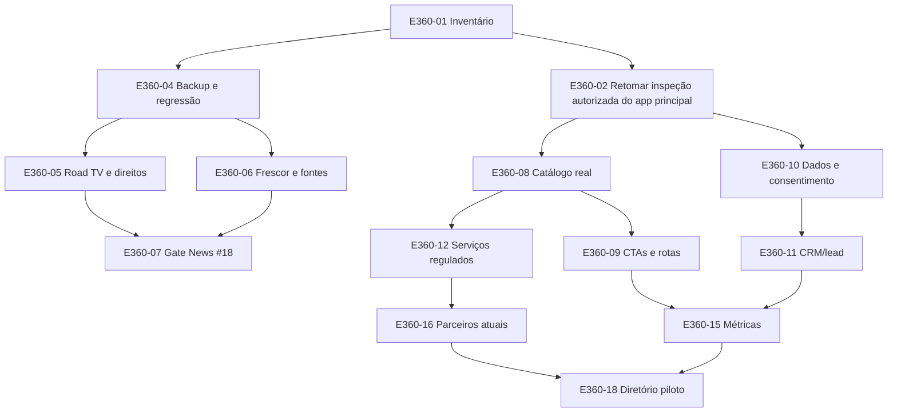

# DRIVMATCH ECOSYSTEM 360° — MASTER BACKLOG

> **CORREÇÃO DE ESCOPO após acesso real ao app principal (12/10):** E360-02 (recuperação de visibilidade GitHub) está **CONCLUÍDA apenas para acesso read-only**; ainda falta auditoria de Cloudflare/Lovable e banco vivo. E360-18 não é `criar diretório`: é **auditar, fechar lacunas e escalar Marketplace existente**, inclusive `service_requests` e aprovação admin. E360-22 deve integrar/revisar fluxos **já presentes** de carreira/job invitations; E360-23 deve adaptar **DrivMe/requests existentes**; E360-25 deve partir dos **equipment listings existentes**. Não criar novo CRM, tabelas de users, auth ou Stripe por presunção. Documento de evidência: [APP_MAIN_READONLY_AUDIT_2026-10-12.md](APP_MAIN_READONLY_AUDIT_2026-10-12.md). Registrar revisão de `.env` versionado como P0 de segurança, sem ler ou expor segredo nos documentos.

**Consolidado:** 2026-10-12 · **Estado:** proposta técnica/comercial em branch de documentação; nenhum item abaixo está marcado como entregue por este documento.  
**Atenção:** o usuário já vende serviços, forma alunos, opera brokerage e divulga parceiros no Instagram; a estratégia é **integrar, provar e escalar**, não declarar que a operação ainda precisa "lançar" do zero.

## Regras de priorização

- `G0 / P0-BLOCKER`: impede anunciar a News como pronta ou publicar fluxo de alto risco; depende de evidência.
- `P0`: fundação mínima para conectar **oferta existente** de modo verdadeiro e seguro.
- `P1`: piloto de ampliação do ecossistema após o P0 respectivo, sem necessariamente esperar todo roadmap.
- `P2`: produto/experimento posterior quando demonstrar demanda.
- `P3`: pesquisa/negócio futuro, não criar antes de viabilidade e aprovação.
- `HUMAN`: proprietário, editor, operador ou especialista decide; `AI-ASSISTED`: IA apoia, não substitui gate.
- `BLOCKED` significa falta de evidência ou decisão, **não** inexistência comprovada.
- Tarefas que já possuem issue (#18/#59/#36/#35/#88) **devem continuar na issue original**, sem criar substituta; backlog é índice transversal.

## Antes de programar: checkpoint de evidência

O repositório `handsondispatcher/drivmatch-news` está acessível e `content/release.json` indica v34.11 / `development_prelaunch` / `public_launch_approved=false`. Issues #59/#88/#35/#36 e gate #18 estavam abertos na inspeção. **O repositório privado `DrivMatch/drivmatch` JÁ HAVIA SIDO ACESSADO em sessão de navegador autorizada pelo Ricardo, em 09–11/10**; a conexão GitHub **desta sessão** não o lista (404). Infraestrutura-base conhecida: GitHub React/Vite/TypeScript, Lovable com Supabase, Cloudflare Pages `drivmatch-app` publicando `drivmatch.com`; snapshot histórico `snapshot/p1-before-codex-2026-10-11` e commit `b785ab3`. Retomar acesso autorizado; **não solicitar novamente senhas nem assumir inexistência do repositório**.

## Lista ordenada de execução — 28 itens com aceitação

| ID | Prioridade | Ação verificável | Dependência | Owner proposto | Aceite / evidência mínima |
|---|---|---|---|---|---|
| E360-01 | P0 | Inventário técnico/negócios: repos, deploy, domínios, bancos, integrações, serviços, campanhas, parceiros, custos | — | Fundador + tech | Matriz com estado `REPO_VERIFIED`/`USER_DECLARED`/`UNKNOWN`, URL, data, responsável, custo; não inferir |
| E360-02 | P0 | Retomar a inspeção read-only do app principal com acessos JÁ autorizados via navegador/ambiente apropriado; conector GitHub atual pode ser limitado | 01 | Tech/assistente | Conferir branch/HEAD atual, Lovable/Supabase, Pages `drivmatch-app`, rotas e fluxo deploy; registrar evidência sem pedir novamente senhas ao fundador |
| E360-03 | P0 | Conciliar claim/contagem da homepage, pricing e bases; separar alunos vs drivers | 01,02 | Growth + Finance | Contagens auditadas e copy pública sem alegações inconsistentes; registro do antes/depois |
| E360-04 | P0 | Testar backup **e restauração**, CI/regressão, disponibilidade, rollback e segurança básica da News | 01 | DevOps/QA | Evidência datada da recuperação em ambiente apropriado, teste de PR e screenshots; não alterar backups congelados |
| E360-05 | G0 | Fechar issue News #59/#35/#88: Road TV com playback visível/embeddable ou indisponibilidade honesta | 01,04 | Dev + QA + Editorial | Desktop/mobile reais sem bloqueio/black screen falsamente anunciado; direitos/status LIVE corretos |
| E360-06 | G0 | Fechar issue News #36/#59: frescor jornalístico real, feeds, fontes e status | 01,04 | Editorial + Data | Datas originais verificadas, estado de atualização visível, monitor de erro; não publicar RSS como reportagem original |
| E360-07 | G0 | Concluir gate News #18: direitos, foto, idiomas, UX, social-share, clima/mercado, SEO, acessibilidade e publicação | 04,05,06 | Fundador + Editor + QA | Evidências vinculadas por item e autorização explícita; até lá `public_launch_approved=false` |
| E360-08 | P0 | Catálogo **real** de ofertas e execução: cursos, consultoria, DOT/MC/etc., frete, recrutamento | 01 | Fundador + Operações | Por serviço: operador, preço/condições efetivos, público, escopo, CTA, canal de atendimento, elegibilidade |
| E360-09 | P0 | Auditar jornada News→site para ofertas reais; sem criar novo matching no News | 02,08 | Product + Dev | Links/contexto corretos; sem erro 404; lead chega ao serviço realmente entregue |
| E360-10 | P0 | Mapa de dados, permissões e consentimentos dos cadastros atuais/alunos | 01,02 | Privacy + Operações | Inventário de finalidade/base/autorização/retention, duplicatas; plano antes de envio comercial |
| E360-11 | P0 | Definir CRM e lead routing **usando sistema existente se houver** | 02,08,10 | Product + Ops + Dev | 3 fluxos testes: origem→lead→owner→resposta→fechamento, log sem exposição indevida |
| E360-12 | P0 | Revisar serviço regulado e obrigações: brokerage, transporte, DOT services, TWIC, seguros, advogados, recrutamento | 08,10 | Especialistas + Fundador | Matriz serviços × jurisdição × licença/authority × claim permitido × termos; pendências críticas bloqueiam ofertas afetadas |
| E360-13 | P0 | Separar comercial/editorial: anúncio, publi, coluna, reportagem e referral; conflito e correção | 01,08 | Editor + Comercial | Política revisada, labels e exemplos; pagamento não altera recomendações/editorial |
| E360-14 | P0 | Plano de operação: canal suporte, incidentes, abuso, denúncia de fraude, backups, incident owner e horas de atendimento | 04,08,11 | Fundador + Operações | Procedimentos testados; sem prometer suporte permanente sem escala humana |
| E360-15 | P0 | Medição inicial real: fonte (Instagram/News/SEO), clique, lead consentido, retorno e receita recebida | 09,11 | Growth + Finance | Eventos verificados ponta a ponta, definição KPI, painel básico sem dados inventados |
| E360-16 | P1 | Inventariar parcerias atuais (Oficina Gorila, divulgação seguro, dispatchers, outros) e termos | 08,12,13 | Fundador + Comercial | Relações, contatos, área, tipo de divulgação, permissão, escopo e modelo de receita **não presumido** |
| E360-17 | P1 | Links rastreáveis da divulgação atual Instagram→landing/service com consentimento | 09,15,16 | Growth + Dev | Um piloto real com origem atribuível e privacidade respeitada; não alegar retorno até medido |
| E360-18 | P1 | Diretório de prestadores **MVP**: decidir reaproveitar listagem existente ou pequena página | 02,11,12,16 | Product + Dev | 2–5 prestadores consentidos/validados, áreas e limites corretos, CTA funcional, exclusão/correção |
| E360-19 | P1 | Programa editorial de especialistas (ex.: advogado tickets, oficina) | 07,12,13,16 | Editor + Comercial | Credenciais e conflitos revisados, primeira coluna realmente aprovada e rotulada corretamente |
| E360-20 | P1 | Programa mídia/creator (Paulo Landim / Road TV como prospects) | 07,13 | Fundador + Legal + Media | Relação formal, titular dos direitos, consentimento, embed/licença e atribuição documentados antes de reproduzir |
| E360-21 | P1 | Mídia-kit comercial e contrato piloto de patrocínio | 13,15,16 | Comercial + Legal | Inventário de espaços disponíveis, audiência **real**, preço somente aprovado, transparência e entrega aferível |
| E360-22 | P1 | Jornada driver/carrier de vaga e recrutamento B2B, reutilizando capacidades atuais | 02,08,10,11,12 | Recruiting + Product | Vaga real, consentimento, inscrição, encaminhamento, status, cobrança só se aprovada e permitida |
| E360-23 | P1 | Jornada pessoa física→cotação de transporte de veículo/frete | 02,08,11,12 | Freight Ops + Product | Solicitação válida, operador responsável, condições/authority/seguro, cotação, aceite e contato |
| E360-24 | P1 | Preparar English Lab para piloto condicional, sem fingir curso já aberto | 08,10,11,15 | Educação + Product | Oferta, instrutor/conteúdo, duração, preço, política e captação consentida; aprovação do fundador |
| E360-25 | P2 | Expansão classificado/marketplace self-service, moderação, fraude e preço | 18,22,23 | Product + Security | Demanda e taxa de abuso documentadas; aprovação econômica e de risco antes de construção |
| E360-26 | P2 | Analytics avançado de cohort, retenção, cross-sell, custo de IA e margem de contribuição | 15 e pilotos | Finance + Data | Relatório reconciliado, sem misturar receita de parceiros/fundos de clientes com receita própria |
| E360-27 | P2 | Distribuição ampliada em EN/ES, parceiros e especialistas locais | 07,15,19,20 | Editorial + Growth | Direitos, idiomas, credibilidade e custo de aquisição medidos por canal/idioma |
| E360-28 | P3 | Estudar storage/parking, DrivMe, DrivPoints/rewards, wallet e government verticals | 26 e necessidade demonstrada | Fundador + Especialistas | Business case separado por vertical e análise regulatória; nenhum código ou cobrança sem decisão |

### Relação com as 20 atividades do Gemini

O relatório Gemini é **insumo, não execução concluída**. Reaproveitar ideias sem importar prioridades incorretas:
- `EXP-01`/20 → E360-05/06/07: **testes verdes não bastam** para aprovação de News; exigir experiências reais e gate humano.
- `EXP-02` → E360-10: **não juntar bases antes de revisar finalidade e consentimento**; deduplicar com governança.
- `EXP-03/04/05/10` → E360-16/18/17/11: **primeiro piloto e rastreio**, depois diretório escalável.
- `EXP-06` → E360-12: disclaimers **não substituem licenças, contratos ou revisão regulatória**.
- `EXP-08` → E360-06/07/13: auditar controles editoriais existentes, em vez de instalar "trava anti-alucinação" duplicada.
- `EXP-12/13/17` → E360-04/07/14: mobile, backups/restore e acessibilidade são **gate**, não P2/P3 para depois.
- `EXP-16/18` → E360-04/15: carga e métricas prioritárias proporcionais à operação, não dashboards antes de instrumentar.
- `EXP-09` → E360-24: English Lab é piloto, não afirmar curso vigente.
- `EXP-07/11/14/19` → E360-21/19/22/16: aproveitar audiência e parceiros já existentes.

## Grafo de dependências crítico

## Rotinas paralelas / não bloquear a empresa inteira

- A operação comercial do fundador continua ativa conforme aplicável; **o bloqueio de lançamento News não deve ser interpretado como proibição de cursos, consultorias ou Instagram já existentes**.
- Mapeamento de ofertas/parceiros, contratos, consentimento e analytics pode avançar em paralelo à homologação News.
- Publicidade paga no News só após inventário real, direitos, contrato e autorização comercial; enquanto News prelaunch, o `release.json` documenta apenas house ads.
- Alterar homepage do app principal depende de **retomar o ambiente já autorizado** e obter testes/deploy adequados; não editar o repositório News para simular trabalho no app principal.

## Gates e matriz Go/No-Go

| Gate | Necessário antes de | Evidência | Decisor |
|---|---|---|---|
| G-NEWS | Anunciar News aberta publicamente | #18/#59/#36 e ensaio editorial, conteúdo, direitos, live, mobile, social share | Fundador + editor |
| G-DATA | Usar banco legado para nova campanha/cross-sell | finalidade/consentimento, opt-out e auditoria | responsável de dados + fundador |
| G-SERVICES | Ofertar atividade nova regulada, anunciar claims de licença | revisão por jurisdição, operador/autoridade e condições | especialista habilitado + fundador |
| G-PARTNERS | Publicar anunciante/prestador/colunista | direitos, contrato, disclosure, verificação | comercial + editor |
| G-LEADS | Direcionar leads de produção | E2E real, monitoramento, retenção e incident response | operações + produto |
| G-COMMERCIAL | Cobrar novo plano ou comissão | preço/escopo, regras, cobrança, reembolso, impostos e consentimento | fundador + finanças |
| G-RELEASE | Alterar main/deploy/status | CI + regressão + screenshots + rollback + aprovação | responsável técnico + fundador |

**Se qualquer item obrigatório para uma função faltar, oferecer caminho alternativo transparente (p. ex. link externo, atendimento humano ou funcionalidade indisponível). Não "fechar" gate com linguagem de relatório.**

## Cadência sugerida por entregas, não datas inventadas

- **Sprint de evidência:** E360-01/02/03/04/08/10/16; registrar o que já existe.
- **Sprint de contenção editorial:** E360-05/06/07 (continuar nas issues abertas).
- **Sprint de integração simples:** E360-09/11/12/13/14/15; no mínimo três jornadas de ponta a ponta.
- **Pilotos comerciais:** E360-17/18/19/20/21/22/23/24, somente conforme gates próprios.
- **Escala:** E360-25/26/27/28 condicionados a métricas e novas decisões.

Nenhuma dessas fases é prazo. Estimar esforço após auditoria do app principal e custo de execução.

## Organização e próximos passos técnicos

No Codex, executar **primeiro** auditoria de leitura sobre `drivmatch-news` (sem alterar runtime), conferindo release, workflows, issues, evidências de navegadores, lacunas e plano de correção. No app principal, usar os acessos já liberados pelo Ricardo via contexto/ambiente apropriado; a falta de acesso ao repositório privado pelo conector **deste chat** não equivale a falta de autorização. Não abrir issues repetidas. Mudanças técnicas futuras em PRs pequenos, com aceite e rollback rastreáveis.

Transição segura de chats: ler [PROJECT_HANDOFF.md](PROJECT_HANDOFF.md), [ECOSYSTEM_MASTER.md](ECOSYSTEM_MASTER.md) e registros de decisões antes de responder. Não fazer o usuário repetir o briefing.
